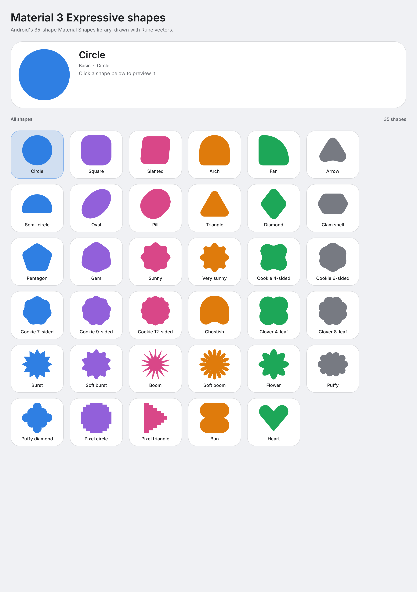
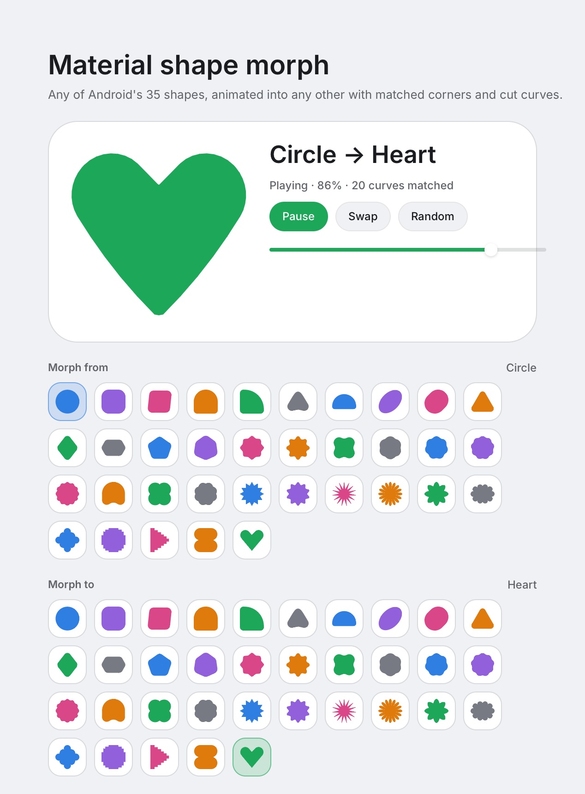
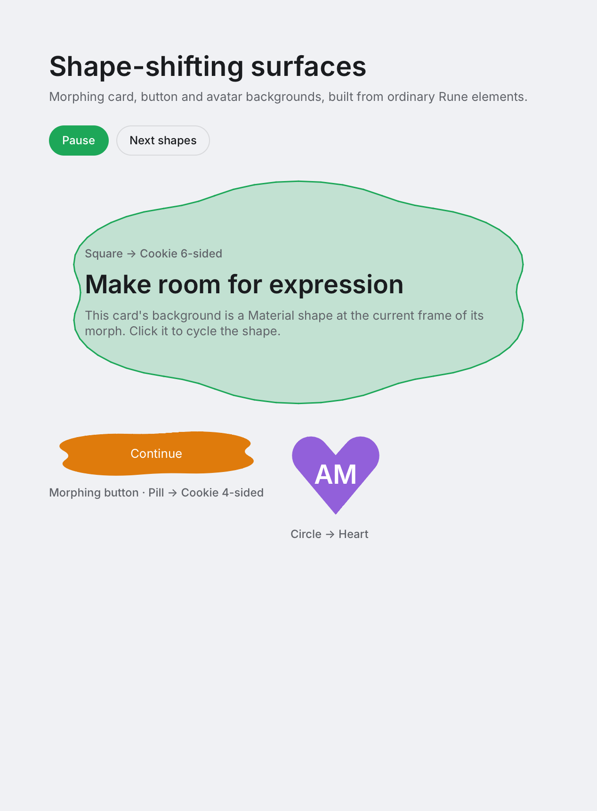

# rune-material-shapes

Material 3 Expressive's shape library for [Rune](https://github.com/anomalyco/rune).

Android's expressive update added 35 shapes — the basic outlines, cookies, clovers, bursts, and
one-offs such as the heart and the bun — built from rounded polygons with corner rounding and
smoothing. This crate ports that geometry to Rust and paints it with Rune's vector shapes, so a
shape fills any element at any scale and themes with the app.



## Install

This crate is consumed from Git alongside the Rune revision it targets. Pin both to the same Rune
revision so Cargo resolves one copy of the framework:

```toml
[dependencies]
rune = { git = "https://github.com/anomalyco/rune", rev = "27e9745df15c83be7b0ba225c9f9f10c892a157e" }
rune-material-shapes = { git = "https://github.com/threehymns/rune-material-shapes" }
```

The library enables Rune by default. For the geometry alone, without Rune or any of its
dependencies:

```toml
rune-material-shapes = { git = "https://github.com/threehymns/rune-material-shapes", default-features = false }
```

## Usage

```rust
use rune::tok;
use rune_material_shapes::{MaterialShape, PaintStyle, shape_canvas};

let avatar = shape_canvas(
    MaterialShape::Clover4Leaf,
    96.0,
    PaintStyle::Filled,
    tok::accent(4, true),
);
```

`shape_canvas` returns a square `El`, ready to go in a row or over an image. For lower-level work,
`MaterialShape::polygon()` returns a `RoundedPolygon`; `paint` turns one into a Rune `Shape`,
`outline` returns its flattened points, and `RoundedPolygon::normalized()` puts any polygon in the
unit square. The geometry has no Rune dependency (build with `default-features = false`).

## Morphing

`Morph` animates between any two shapes, the way Android's `androidx.graphics.shapes.Morph` does:
it measures each outline, maps corners to their closest compatible counterpart (convex to convex,
concave to concave), cuts the longer curves where the mappings cross, and pairs the resulting
cubics one to one. Ask it for the shape at any progress:

```rust
use rune_material_shapes::{MaterialShape, Morph};

let morph = Morph::new(MaterialShape::Circle.polygon(), MaterialShape::Heart.polygon());
let halfway = morph.polygon(0.5);
let points = morph.outline(0.5, 0.0015);
```



Progress is linear and values outside `0..=1` extrapolate, so callers can apply their own easing or
overshoot. `curve_count()` reports how many pairs the match produced, and `bounds()` is the union of
both shapes' bounds. Every one of the 1,225 ordered pairs is tested for clean intermediate outlines
and for exact start and end shapes.

The playground's **Material 3/Morph** story drives `MorphDemo`, a ping-ponging preview with
play/pause, Swap and Random buttons, a scrubbable progress bar, and a row of all 35 shapes for each
endpoint. `MorphDemo` is a normal view over its own state, so an app can reuse `morph_demo` or call
`Morph::polygon(progress)` directly from its own animation.

## Morphing surfaces

`morph_paint` gives the shape at a progress as a Rune `Shape`, and `shaped` paints it beneath any
element's content, so ordinary cards, buttons and avatars can change silhouette:

```rust
use rune::{el, Color};
use rune_material_shapes::{MaterialShape, Morph, PaintStyle, shaped};

let morph = Morph::new(MaterialShape::Square.polygon(), MaterialShape::Arch.polygon());
let card = shaped(
    el().w_full().h(240.0).padding(32.0),
    &morph,
    0.5,
    PaintStyle::Soft,
    Color::WHITE,
);
```



Rune has no arbitrary path clipping, so `shaped` paints the silhouette behind the content rather
than clipping it; content stays inset, and the element's hit area remains rectangular. The
**Material 3/Surfaces** playground story shows this with a morphing card, button and avatar, each
on its own duration and with Play/Pause and Next shapes controls.

The catalog is `MaterialShape::ALL`, in Android's `MaterialShapes` order, and `MaterialShapes` is an
alias for it, so `MaterialShapes::Cookie12Sided` reads like `MaterialShapes.Cookie12Sided`:

| Category | Shapes |
| --- | --- |
| Basic | Circle, Square, Slanted, Arch, Fan, Arrow, SemiCircle, Oval, Pill, Triangle, Diamond, ClamShell, Pentagon, Gem |
| Cookies | Sunny, VerySunny, Cookie4Sided, Cookie6Sided, Cookie7Sided, Cookie9Sided, Cookie12Sided |
| Clovers | Ghostish, Clover4Leaf, Clover8Leaf |
| Bursts | Burst, SoftBurst, Boom, SoftBoom, Flower |
| Unique | Puffy, PuffyDiamond, PixelCircle, PixelTriangle, Bun, Heart |

## The playground

`playground()` adds a "Material 3" group to Rune's playground (⌘⇧D, Ctrl+Shift+D): an all-shapes
story, one per category, a Morph story, a Surfaces story, and Filled/Outlined/Soft variants in the
side column. Click a tile to preview that shape at 136 pt, or choose either end of the morph.
`examples/material-shapes.rs` wires it up:

```sh
cargo run --example material-shapes
cargo run --example material-shapes -- --playground "Material 3/All shapes"
cargo run --example material-shapes -- --playground "Material 3/Morph"
cargo run --example material-shapes -- --playground "Material 3/Surfaces"
cargo run --example material-shapes -- --playground "Material 3/Bursts" --variant Outlined
cargo run --example material-shapes -- --snap shapes.png --size 1100x1900
```

The gallery is also a normal view, `gallery`, over `Gallery` state, so an app can embed it directly.

## Fidelity

The geometry is a port of `androidx.graphics.shapes.RoundedPolygon` and the definitions are
transcribed from `androidx.compose.material3.MaterialShapes` (both Apache-2.0): the same vertices,
radii, smoothing, mirroring, repetitions and transforms. Normalization is uniform, as Android's
`normalized()` is, so an oval stays an oval. Tests check the unit-square bounds, that every outline
is simple enough for Rune's ear-clipped fills, that mirrored shapes have their mirror axis, and that
the circle is round.

`PAINT_TOLERANCE` flattens curves to 0.0015 of the unit square (about half a point on a 320 pt
canvas); pass a tighter tolerance to `RoundedPolygon::outline` for larger artwork.

`Morph` is a port of `androidx.graphics.shapes.Morph`, including `LengthMeasurer`,
`MeasuredPolygon`, `DoubleMapper`, feature matching and curve cutting (Apache-2.0).

## Licensing

The whole crate is licensed under the Apache License, Version 2.0 ([LICENSE](LICENSE)).
`catalog.rs`, `geometry.rs`, `math.rs` and `morph.rs` are Rust ports of AndroidX Graphics Shapes —
`androidx.graphics.shapes` (`RoundedPolygon`, `Cubic`, `CornerRounding`, `Point`, `Morph`) and
`androidx.compose.material3.MaterialShapes` — copyright 2022, 2024 The Android Open Source Project,
modified from those Apache-2.0 sources. Everything else is original work under the same license.
